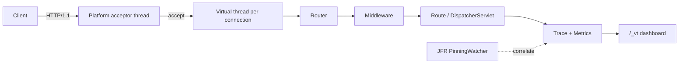

# Glint

[](https://openjdk.org/)
[](LICENSE)
[](pom.xml)
[](https://github.com/ChensirJ/glint)

> **Drop-in virtual-thread server with built-in diagnostics — see why your request is slow.**

Glint is a JDK 21+ HTTP server that runs every connection on a **virtual thread**, ships a live **`/_vt` diagnostics dashboard**, and can replace **Tomcat** in Spring Boot 3.2+ with a single starter dependency.

<p align="center">
  
</p>

## Why Glint?

| Pain with classic servlet containers | What Glint does |
|--------------------------------------|-----------------|
| Platform thread pools need careful sizing | `Executors.newVirtualThreadPerTaskExecutor()` — one VT per connection |
| Slow requests are opaque | Built-in Trace spans + P50/P99 histograms + slow-request ring |
| JDK 21 pinning is silent | JFR `jdk.VirtualThreadPinned` watcher with truncated stacks in `/_vt` |
| Tomcat swap is heavy | Spring Boot starter implements `WebServer` / `ServletWebServerFactory` |

<p align="center">
  
</p>

## Architecture



## Modules

| Module | Description |
|--------|-------------|
| `glint-core` | HTTP parser (Content-Length + chunked), VT server, router, middleware, Trace, Metrics, PinningWatcher (**zero** third-party deps) |
| `glint-dashboard` | Modern dark `/_vt` UI (self-contained CSS/JS, inline SVG) |
| `glint-servlet` | Jakarta Servlet 6 adapter (enough for Spring MVC Hello World) |
| `glint-spring-boot-starter` | Drop-in Tomcat replacement |
| `glint-examples` | Standalone + Spring Boot demos |

## Quick start — standalone

```java
import io.github.glint.Glint;
import io.github.glint.middleware.Middlewares;
import io.github.glint.obs.Trace;

public class App {
    public static void main(String[] args) throws Exception {
        Glint.create(8080)
            .before(Middlewares.requestLogging())
            .before(Middlewares.cors())
            .get("/hello", (req, resp) -> resp.text("Hello, virtual threads!"))
            .get("/users/{id}", (req, resp) -> {
                String json = Trace.span("db.findUser", () ->
                    "{\"id\":\"" + req.pathParam("id") + "\"}");
                resp.json(json);
            })
            .diagnostics("/_vt")
            .start();
    }
}
```

```bash
# Windows
.\scripts\run-standalone.ps1

# macOS / Linux
chmod +x scripts/run-standalone.sh && ./scripts/run-standalone.sh

# or plain Maven (exec plugin is configured on glint-examples)
mvn -pl glint-examples -am exec:java -Dexec.mainClass=io.github.glint.examples.StandaloneDemo
```

Open http://127.0.0.1:8080/_vt

## Quick start — Spring Boot 3.2+

**Exclude Tomcat** and add the Glint starter:

```xml
<dependency>
  <groupId>org.springframework.boot</groupId>
  <artifactId>spring-boot-starter-web</artifactId>
  <exclusions>
    <exclusion>
      <groupId>org.springframework.boot</groupId>
      <artifactId>spring-boot-starter-tomcat</artifactId>
    </exclusion>
  </exclusions>
</dependency>
<dependency>
  <groupId>io.github.glint</groupId>
  <artifactId>glint-spring-boot-starter</artifactId>
  <version>0.1.0-SNAPSHOT</version>
</dependency>
```

```bash
# Windows
.\scripts\run-spring.ps1

# Maven profile enables spring-boot repackage / run
mvn -pl glint-examples -am -Pspring-demo spring-boot:run
```

Demo listens on **8081** (`application.properties`). Open http://127.0.0.1:8081/hello and http://127.0.0.1:8081/_vt

## HTTP features (0.1+)

- Methods: GET, HEAD (falls back to GET), POST, PUT, DELETE, PATCH, OPTIONS
- Query string decoding, path params `{id}`
- Request bodies: `Content-Length` and **chunked** transfer encoding
- Limits: max body / header line, idle keep-alive timeout, graceful drain on shutdown
- Responses: charset-aware text/json/html, proper 400 / 404 / 405 / 413 / 500 JSON errors
- Middleware helpers: CORS, request logging, exception → JSON

## JDK 21 notes

- Uses **`ThreadLocal`** for request context (not preview `ScopedValue`).
- Hot paths avoid **`synchronized`** — prefer `ReentrantLock` / concurrent collections.
- `PinningWatcher` listens for `jdk.VirtualThreadPinned` via `RecordingStream`.

## Build & test

```bash
mvn -q verify
```

Requires **JDK 21+** and **Maven 3.9+**.

## Roadmap

- [x] Virtual-thread HTTP/1.1 core + keep-alive
- [x] Chunked request body decode, query params, HEAD/PUT/DELETE/OPTIONS
- [x] Path params, middleware, diagnostics JSON + modern `/_vt` dashboard
- [x] Slow-request + pinning event rings for the UI
- [x] Servlet adapter + Spring Boot starter (Hello World)
- [ ] OpenTelemetry OTLP exporter (hooks via Metrics.snapshot today)
- [ ] Multipart upload
- [ ] Broader Servlet 6 coverage (session, async, WebSocket)
- [ ] Published JMH vs Tomcat / Undertow / Jetty
- [ ] GraalVM native-image recipe for standalone mode

## Out of scope (0.1)

Full Servlet 6, HTTP/2/3, TLS termination, DI/ORM frameworks.

## Contributing

See [CONTRIBUTING.md](CONTRIBUTING.md). Issues tagged `good first issue` are a great place to start.

## License

[Apache License 2.0](LICENSE)
