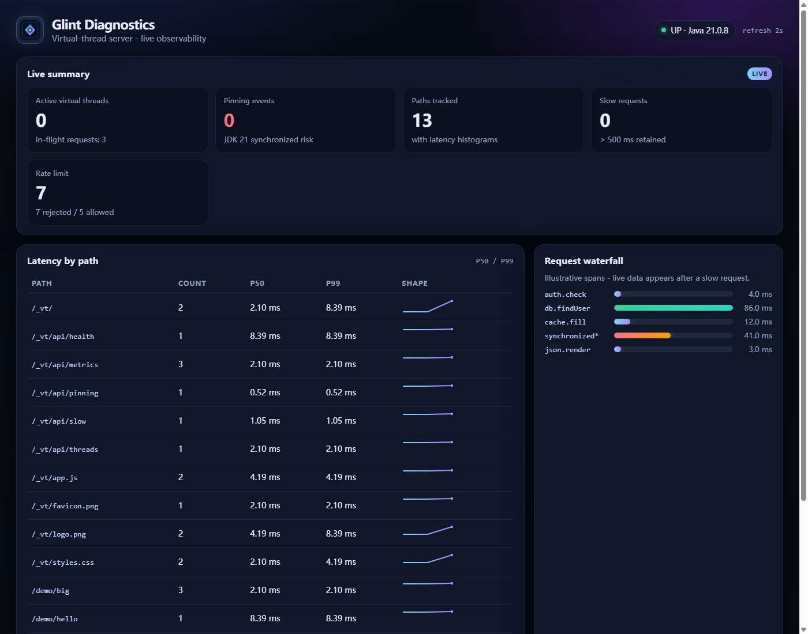

# Glint

<p align="center">
  
</p>

[](https://openjdk.org/)
[](LICENSE)
[](pom.xml)
[](https://github.com/ChensirJ/glint)

> **Drop-in virtual-thread server with built-in diagnostics  - see why your request is slow.**

Glint is a JDK 21+ HTTP server that runs every connection on a **virtual thread**, ships a live **`/_vt` diagnostics dashboard**, and can replace **Tomcat** in Spring Boot 3.2+ with a single starter dependency.

<p align="center">
  <!-- Real screenshot: Chrome headless against running demo http://127.0.0.1:8090/_vt (Asia/Shanghai) -->
  
</p>
<p align="center">
  
</p>

## Feature gallery demo

A separate living demo lives next to this repo at **`D:\glint-demo`** (sibling folder; not published as part of this git tree).

**Convention:** whenever Glint gains a capability, `glint-demo` is updated in the **same turn** so `/features` stays an accurate gallery of what the server can do.

```bash
# from Glint root  - install artifacts into local .m2
mvn -q clean install -DskipTests
# then
cd ..\glint-demo
.\scripts\run.ps1
```

## Why Glint?

| Pain with classic servlet containers | What Glint does |
|--------------------------------------|-----------------|
| Platform thread pools need careful sizing | `Executors.newVirtualThreadPerTaskExecutor()`  - one VT per connection |
| Slow requests are opaque | Built-in Trace spans + P50/P99 histograms + slow-request ring |
| JDK 21 pinning is silent | JFR `jdk.VirtualThreadPinned` watcher with truncated stacks in `/_vt` |
| Tomcat swap is heavy | Spring Boot starter implements `WebServer` / `ServletWebServerFactory` |

## Modules

| Module | Description |
|--------|-------------|
| `glint-core` | HTTP parser (Content-Length + chunked + **multipart**), static mounts, VT server, router, middleware (CORS/accessLog/rateLimit), Trace, Metrics, PinningWatcher, OTLP JSON export hooks (**zero** third-party deps) |
| `glint-dashboard` | Modern dark `/_vt` UI |
| `glint-servlet` | Jakarta Servlet 6 adapter (sessions, multipart `Part`s, async stub) |
| `glint-spring-boot-starter` | Drop-in Tomcat replacement |
| `glint-examples` | Standalone + Spring Boot demos |
| `glint-bench` | Throughput / latency microbench harness |

## Quick start - standalone

Yes, you can use it that way - but you still need a `main` method (README snippets often omit the class for brevity). Full runnable program:

```java
import io.github.glint.Glint;
import io.github.glint.middleware.Middlewares;

public class Main {
    public static void main(String[] args) throws Exception {
        Glint.create(8080)
            .before(Middlewares.requestLogging())
            .before(Middlewares.cors())
            .get("/hello", (req, resp) -> resp.text("Hello, virtual threads!"))
            .diagnostics("/_vt")
            .startAsync(); // non-blocking start

        Thread.currentThread().join(); // keep the JVM alive
    }
}
```

Bundled entry point with a real `main`: `io.github.glint.examples.StandaloneDemo`.

```bash
.\scripts\run-standalone.ps1
# Open http://127.0.0.1:8080/hello and http://127.0.0.1:8080/_vt/
```

## HTTP features (0.1+)

- Methods: GET, HEAD, POST, PUT, DELETE, PATCH, OPTIONS
- Query string, path params `{id}`, greedy `{*path}`
- Bodies: `Content-Length`, **chunked**, **`multipart/form-data`** (size-limited)
- **Static mounts**: `Glint.staticFiles(prefix, Path)` and `classpathFiles(prefix, root)` with MIME, HEAD, basic `Range`, path-traversal checks
- Limits / idle timeout / **fast graceful shutdown** (force-closes keep-alive sockets)
- Optional **TLS** via `ServerConfig.builder().sslContext(SSLContext)`
- Diagnostics: `/_vt`, metrics, slow, pinning, **`/_vt/api/otlp/v1/metrics`** (OTLP/HTTP JSON, no SDK dep)
- ObsExporter SPI (`ServiceLoader`) for custom exporters
- Middleware: **CORS** (`CorsOptions`), **accessLog** / `requestLogging`, **token-bucket rateLimit**, exception -> JSON
- Cookies: multiple **`Set-Cookie`** header lines (`resp.cookie(...)` / `addCookie`)
- WebSocket / HTTP Upgrade via `Glint.websocket(path, handler)` (RFC 6455, HTTP/1.1): **text**, **binary**, **ping/pong** (auto-reply), **close codes**, **fragmented message reassembly**

### Static files + middleware (complete `main`)

```java
import io.github.glint.Glint;
import io.github.glint.middleware.CorsOptions;
import io.github.glint.middleware.Middlewares;
import java.nio.file.Path;

public class Main {
    public static void main(String[] args) throws Exception {
        Glint.create(8080)
            .before(Middlewares.accessLog())
            .before(Middlewares.cors(CorsOptions.builder()
                .allowOrigin("*")
                .exposeHeaders("Content-Range")
                .build()))
            .before(Middlewares.rateLimit(100, 50))
            .staticFiles("/assets", Path.of("public"))
            .classpathFiles("/web", "static/web")
            .get("/hello", (req, resp) -> resp.text("ok"))
            .diagnostics("/_vt")
            .startAsync();
        Thread.currentThread().join();
    }
}
```

## Benchmarks

Side-by-side harness (`glint-bench` / `ComparisonBench`) starts **Glint** and **Tomcat embed 10.1.24** on ephemeral ports, then hits `/hello` with the same Java `HttpClient` (HTTP/1.1, virtual-thread workers).

### Latest numbers (maintainer machine)

Captured **2026-10-30 14:17:49 CST** (Asia/Shanghai). Full notes: [`docs/bench-results.md`](docs/bench-results.md).

| Server | req/s | errors | p50 (ms) | p99 (ms) | max (ms) |
|--------|------:|-------:|---------:|---------:|---------:|
| Glint | 52,281 | 0 | 0.95 | 4.84 | 14.43 |
| Tomcat embed | 46,779 | 0 | 1.20 | 4.37 | 12.50 |

**Delta (this run):** Glint is about **+11.8%** req/s vs Tomcat embed; p50 lower; p99/max similar.

> Numbers are machine-local and not a guarantee of production ranking. At lower concurrency Tomcat may lead -- re-run before quoting.

```bash
mvn -pl glint-bench -am -q package
mvn -pl glint-bench -q exec:java -Dexec.mainClass=io.github.glint.bench.ComparisonBench -Dexec.args="2 5 64"
```

## OpenTelemetry

- Zero required deps in `glint-core`.
- Pull metrics as OTLP/HTTP JSON: `GET /_vt/api/otlp/v1/metrics`.
- Push via SPI: implement `io.github.glint.obs.ObsExporter` and register in `META-INF/services/`.

## JDK 21 notes

- `ThreadLocal` for request context (not preview `ScopedValue`).
- Hot paths avoid `synchronized`  - prefer `ReentrantLock` / concurrent collections.
- `PinningWatcher` listens for `jdk.VirtualThreadPinned` via `RecordingStream`.

## Build & test

```bash
mvn -q verify
mvn -q install   # needed before running ../glint-demo
```

Requires **JDK 21+** and **Maven 3.9+**.

## Roadmap

- [x] Virtual-thread HTTP/1.1 core + keep-alive + fast shutdown
- [x] Chunked + multipart bodies, query params, HEAD/PUT/DELETE/OPTIONS
- [x] Path params, middleware, diagnostics JSON + `/_vt` dashboard
- [x] OTLP/HTTP JSON metrics endpoint + ObsExporter SPI
- [x] Optional TLS via SSLContext
- [x] Microbench module (`glint-bench`)
- [x] Servlet adapter + Spring Boot starter (Hello World)
- [ ] Full OTLP trace export / SDK bridge module
- [x] Servlet sessions (`JSESSIONID`), multipart `Part`s, async `startAsync`/`complete` stub
- [x] WebSocket HTTP/1.1 Upgrade: text, binary, ping/pong, close codes, fragmented messages (Glint.websocket)
- [x] Static file mounts (directory + classpath) with MIME / HEAD / Range
- [x] Middleware helpers: CORS options, accessLog, token-bucket rateLimit
- [x] Multi `Set-Cookie` header support (`HttpResponse.cookie`)
- [ ] Published JMH vs Tomcat / Undertow / Jetty with CI numbers
- [ ] GraalVM native-image recipe for standalone mode

## Out of scope (0.1)

Full Servlet 6 surface, HTTP/2/3, DI/ORM frameworks.

## Contributing

See [CONTRIBUTING.md](CONTRIBUTING.md). Keep **`glint-demo`** (`D:\glint-demo`) in sync when adding user-visible features.

## License

[Apache License 2.0](LICENSE)
