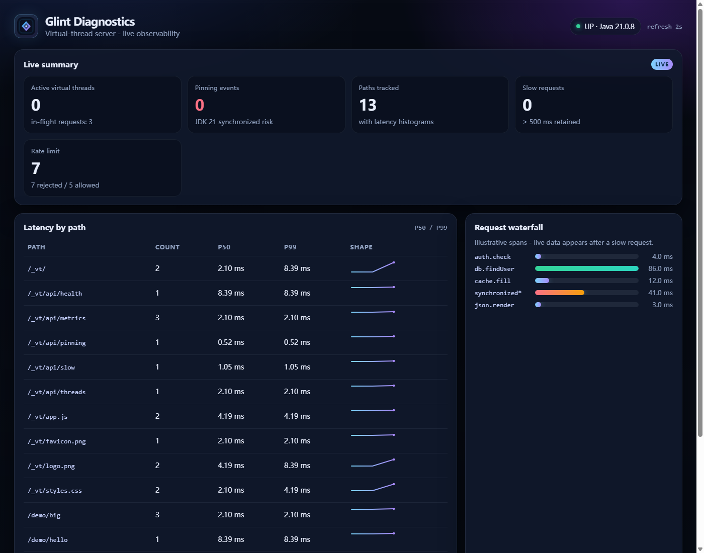

# Glint

<p align="center">
  
</p>

[](https://openjdk.org/)
[](LICENSE)
[](pom.xml)
[](https://github.com/ChensirJ/glint/actions/workflows/ci.yml)

> **Drop-in virtual-thread server with built-in diagnostics  - see why your request is slow.**

Glint is a JDK 21+ HTTP server that runs every connection on a **virtual thread**, ships a live **`/_vt` diagnostics dashboard**, and can replace **Tomcat** in Spring Boot 3.2+ with a single starter dependency.

<p align="center">
  <!-- Real screenshot: Chrome headless against running demo http://127.0.0.1:8090/_vt -->
  
</p>
<p align="center">
  
</p>

## Feature gallery demo

A local gallery demo lives in the sibling folder `glint-demo` (not published as part of this git tree).

**Convention:** whenever Glint gains a capability, `glint-demo` is updated in the **same turn** so `/features` stays an accurate gallery of what the server can do.

```bash
# from Glint root  - install artifacts into local .m2
mvn -q clean install -DskipTests
# then
cd ../glint-demo
.\scripts\run.ps1
```

## Why Glint?

| Pain with classic servlet containers | What Glint does |
|--------------------------------------|-----------------|
| Platform thread pools need careful sizing | `Executors.newVirtualThreadPerTaskExecutor()`  - one VT per connection |
| Slow requests are opaque | Built-in Trace spans + P50/P99 histograms + slow-request ring |
| JDK 21 pinning is silent | JFR `jdk.VirtualThreadPinned` watcher with truncated stacks in `/_vt` |
| Tomcat swap is heavy | Spring Boot starter implements `WebServer` / `ServletWebServerFactory` |

## Modules

| Module | Description |
|--------|-------------|
| `glint-core` | HTTP parser (Content-Length + chunked + **multipart**), static mounts (ETag/304), VT server, router, middleware (CORS/accessLog/rateLimit/compress), Trace, Metrics, PinningWatcher, OTLP JSON export hooks (**zero** third-party deps) |
| `glint-dashboard` | Modern dark `/_vt` UI |
| `glint-servlet` | Jakarta Servlet 6 adapter (filter chain, sessions, multipart `Part`s, async stub) |
| `glint-spring-boot-starter` | Drop-in Tomcat replacement |
| `glint-examples` | Standalone + Spring Boot demos |
| `glint-bench` | Glint vs Tomcat harness: `/hello`, static files, and a realistic suite (blocking I/O sweep, JSON + DB wait, mixed traffic, keep-alive vs short connections, uploads) against platform-thread Tomcat and Tomcat with virtual threads |

## Quick start - standalone

The bundled sample is a small notes service you can run and copy. `main` only wires config, middleware, routes, and startup. Handlers are separate classes under `glint-examples/src/main/java/io/github/glint/examples/standalone/`:

| Class | Role |
|-------|------|
| `NotesServer` | Loopback bind, access log, `/_vt`, mount routes, shutdown hook, `join` |
| `HealthRoutes` | `GET /health` |
| `HomePage` | `GET /` |
| `NoteRoutes` | JSON CRUD, `/api/notes/{id}`, `?done=`, one SSE snapshot |
| `NoteStore` | In-memory notes |

```bash
./scripts/run-standalone.sh
# Windows: .\scripts\run-standalone.ps1
# or: mvn -pl glint-examples -am exec:java
```

Open http://127.0.0.1:8080/ , http://127.0.0.1:8080/api/notes , and http://127.0.0.1:8080/_vt/ . Ctrl+C runs the shutdown hook (`Glint.stop()`), which stops accepting and drains in-flight requests.

`NotesServer.main`:

```java
public static void main(String[] args) throws Exception {
    int port = args.length > 0 ? Integer.parseInt(args[0]) : 8080;
    Glint app = wire(port);
    app.startAsync();
    Runtime.getRuntime().addShutdownHook(new Thread(app::stop, "glint-shutdown"));
    Thread.currentThread().join();
}
```

`wire` is the composition root (full method in `NotesServer`):

```java
public static Glint wire(int port) throws Exception {
    NoteStore notes = new NoteStore();
    ServerConfig config = ServerConfig.builder()
            .bindAddress(InetAddress.getByName("127.0.0.1"))
            .shutdownWaitMs(5_000L)
            .build();
    Glint app = Glint.create(port)
            .config(config)
            .before(Middlewares.accessLog())
            .diagnostics("/_vt");
    new HealthRoutes().mount(app);
    new HomePage().mount(app);
    new NoteRoutes(notes).mount(app);
    return app;
}
```

Create a note, then read it back (path param `{id}`):

```bash
curl -s -X POST http://127.0.0.1:8080/api/notes \
  -H "Content-Type: application/json" \
  -d "{\"title\":\"Buy milk\",\"body\":\"oat\",\"done\":false}"
curl -s http://127.0.0.1:8080/api/notes/1
```

Ten-line miniature:

```java
import io.github.glint.Glint;
import io.github.glint.middleware.Middlewares;

public class Main {
    public static void main(String[] args) throws Exception {
        Glint.create(8080)
            .before(Middlewares.accessLog())
            .get("/hello", (req, resp) -> resp.text("Hello, virtual threads!"))
            .diagnostics("/_vt")
            .startAsync();
        Thread.currentThread().join();
    }
}
```

Server-Sent Events also have a separate entry point: `io.github.glint.examples.SseDemo`.


## Quick start - Spring Boot 3.2+ (replace Tomcat)

`glint-spring-boot-starter` publishes a `ServletWebServerFactory` ahead of Tomcat
auto-configuration and already excludes `spring-boot-starter-tomcat`. Point
`spring-boot-starter-web` at Glint the same way. Full details:
[`docs/spring-boot.md`](docs/spring-boot.md).

**Maven** (`pom.xml`) - groupId **`io.github.chensirj`** (Java packages stay `io.github.glint.*`):

```xml
<dependencies>
  <dependency>
    <groupId>org.springframework.boot</groupId>
    <artifactId>spring-boot-starter-web</artifactId>
    <exclusions>
      <exclusion>
        <groupId>org.springframework.boot</groupId>
        <artifactId>spring-boot-starter-tomcat</artifactId>
      </exclusion>
    </exclusions>
  </dependency>
  <dependency>
    <groupId>io.github.chensirj</groupId>
    <artifactId>glint-spring-boot-starter</artifactId>
    <version>0.1.0-SNAPSHOT</version>
  </dependency>
</dependencies>
```

Until the starter is on Maven Central, install this repo locally first:

```bash
mvn -q clean install -DskipTests
```

**`application.yml`** (matches the starter; defaults are fine):

```yaml
server:
  port: 8080

glint:
  diagnostics: true   # /_vt dashboard (default true); virtual threads are always on
  static:
    enabled: true
    prefix: /assets
    location: classpath:public   # or a directory path, e.g. ./public
  access-log:
    enabled: true
    format: json                 # text | json
  cors:
    enabled: true
    allowed-origin: https://app.example.com
  rate-limit:
    enabled: true
    permits-per-second: 100
    burst: 50

spring:
  servlet:
    multipart:
      max-file-size: 10MB
      max-request-size: 10MB
```

| Property | Default | Notes |
|----------|---------|-------|
| `server.port` | `8080` | Standard Boot listen port. |
| `server.address` | all interfaces | Bind to one local address (for example `127.0.0.1`). |
| `glint.diagnostics` | `true` | Mount `/_vt`. |
| `glint.static.*` | off | `enabled`, `prefix` (`/static`), `location` (path or `classpath:`), `cache-max-entry-bytes`, `cache-max-total-bytes`, `revalidate-millis`, `cache-control`, `precompressed`, `directory-listing`. Served by Glint before Spring MVC. |
| `glint.access-log.*` | off | `enabled`, `format` = `text` or `json` (JSON Lines). |
| `glint.cors.*` | off | `enabled`, `allowed-origin`, `allowed-methods`, `allowed-headers`, `exposed-headers`, `allow-credentials`, `max-age-seconds`, `short-circuit-options`. |
| `glint.rate-limit.*` | off | `enabled`, `permits-per-second` (`100`), `burst` (`50`); per client IP, 429 + `Retry-After`, `/_vt` exempt. |
| Virtual threads | always on | Not a property; every connection uses a VT. |

Servlet filters registered by Spring (`@Bean Filter`, `FilterRegistrationBean`,
`CharacterEncodingFilter`, Spring Security's filter chain proxy) run in order
before `DispatcherServlet`, with URL-pattern and servlet-name mappings, and can
short-circuit the request. Full reference: [docs/spring-boot.md](docs/spring-boot.md).

**Full application** (same shape as bundled `SpringBootDemo`):

```java
package com.example.demo;

import org.springframework.boot.SpringApplication;
import org.springframework.boot.autoconfigure.SpringBootApplication;
import org.springframework.web.bind.annotation.GetMapping;
import org.springframework.web.bind.annotation.PathVariable;
import org.springframework.web.bind.annotation.RestController;

@SpringBootApplication
public class Application {

    public static void main(String[] args) {
        SpringApplication.run(Application.class, args);
    }

    @RestController
    static class HelloController {

        @GetMapping("/hello")
        String hello() {
            return "Hello from Spring Boot on Glint!";
        }

        @GetMapping("/api/users/{id}")
        String user(@PathVariable("id") String id) {
            return "{\"id\":\"" + id + "\",\"via\":\"spring-mvc\"}";
        }
    }
}
```

Run:

```bash
mvn spring-boot:run
# Open http://127.0.0.1:8080/hello and http://127.0.0.1:8080/_vt/
```

Bundled twin of this example: `io.github.glint.examples.SpringBootDemo`

```bash
.\scripts\run-spring.ps1
# or: mvn -pl glint-examples -am -Pspring-demo spring-boot:run
```

Auto-configuration: `io.github.glint.spring.GlintServerAutoConfiguration` binds
`GlintProperties` (`glint.*`) and registers `GlintServletWebServerFactory` via
`META-INF/spring/org.springframework.boot.autoconfigure.AutoConfiguration.imports`.
Sessions, cookies, multipart, the servlet filter chain, and Spring MVC mapping go through `glint-servlet`.

## HTTP features (0.1+)

- Methods: GET, HEAD, POST, PUT, DELETE, PATCH, OPTIONS
- Query string, path params `{id}`, greedy `{*path}`
- Bodies: `Content-Length`, **chunked**, **`multipart/form-data`** (size-limited); stream large uploads with `req.bodyStream()` / `req.bodyChannel()` (or buffer with `bodyBytes()` / `bodyText()`)
- **SSE**: `SseEmitter.start(resp)` writes `text/event-stream` with `event` / `id` / `data` / `retry` and `: comment` keep-alives; connection closes cleanly when the emitter closes
- **Static mounts**: `Glint.staticFiles(prefix, Path[, StaticOptions])` and `classpathFiles(prefix, root)` with MIME, HEAD, `Range`, path-traversal checks, **ETag** / **Last-Modified**, conditional **304**, **small-file cache** plus a per-path metadata cache (no filesystem calls on hot hits; edits visible within `StaticOptions.revalidateMillis`, default 1000 ms), **zero-copy** `FileChannel.transferTo` for large files on plain TCP, **precompressed** `.br`/`.gz` siblings (`Content-Encoding` + `Vary`), **immutable** `Cache-Control` for fingerprinted names, and optional **directory listing** (`StaticOptions.directoryListing(true)`, off by default; HTML or JSON)
- Limits / idle timeout / **fast graceful shutdown** (force-closes keep-alive sockets)
- Optional **TLS** via `ServerConfig.builder().sslContext(SSLContext)`
- Diagnostics: `/_vt`, metrics, slow, pinning, **`/_vt/api/otlp/v1/metrics`** (OTLP/HTTP JSON, no SDK dep)
- ObsExporter SPI (`ServiceLoader`) for custom exporters
- Middleware: **CORS** (`CorsOptions`), **accessLog** / `requestLogging`, **accessLogJson** (JSON Lines with status/method/path/duration/bytes/remote), **token-bucket rateLimit** (Retry-After + `/_vt` counters), **gzip compress** (`Accept-Encoding`; no Brotli without native deps), exception -> JSON
- Cookies: multiple **`Set-Cookie`** header lines (`resp.cookie(...)` / `addCookie`)
- WebSocket / HTTP Upgrade via `Glint.websocket(path, handler)` (RFC 6455, HTTP/1.1): **text**, **binary**, **ping/pong** (auto-reply), **close codes**, **fragmented message reassembly**

### Static files + middleware (complete `main`)

```java
import io.github.glint.Glint;
import io.github.glint.middleware.CorsOptions;
import io.github.glint.middleware.Middlewares;
import java.nio.file.Path;

public class Main {
    public static void main(String[] args) throws Exception {
        Glint.create(8080)
            .before(Middlewares.accessLog())
            .before(Middlewares.cors(CorsOptions.builder()
                .allowOrigin("*")
                .exposeHeaders("Content-Range")
                .build()))
            .before(Middlewares.rateLimit(100, 50))
            .before(Middlewares.compress())
            .staticFiles("/assets", Path.of("public")) // or StaticOptions.builder()...
            .classpathFiles("/web", "static/web")
            .get("/hello", (req, resp) -> resp.text("ok"))
            .diagnostics("/_vt")
            .startAsync();
        Thread.currentThread().join();
    }
}
```

## Benchmarks

All numbers below come from `glint-bench` on one machine (AMD Ryzen 7 7840HS, 16 logical cores, 31.2 GiB RAM, Windows 11, OpenJDK 21.0.8) against **Tomcat embed 10.1.24**. Full tables, method, and caveats: [`docs/bench-results.md`](docs/bench-results.md). Reproduce everything with:

```powershell
powershell -ExecutionPolicy Bypass -File scripts/run-bench.ps1   # -Rounds 3 -Warmup 3 -Duration 8
```

Numbers are machine-local, loopback-only, and not a guarantee of production ranking. Re-run before quoting.

The realistic harness has three server modes. `glint` is virtual-thread-native: one virtual thread per connection and blocking I/O, with no poller. `tomcat` is embedded Tomcat on the default NIO connector with a platform thread pool (`maxThreads` 200). `tomcat-vt` runs the same servlet app and the same NIO connector, with Tomcat's `StandardVirtualThreadExecutor` on the connector (one virtual thread per request task). Spring Boot 3.2+ turns that executor on with `spring.threads.virtual.enabled=true`. The acceptor and poller stay platform threads. Tomcat-VT is still NIO/Servlet. Enabling virtual threads there is not the same as being virtual-thread-native like Glint. `scripts/run-bench.ps1` measures all three and writes them to `docs/bench-results.md`. Pass `-Servers "glint,tomcat"` to measure only the original pair.

### Realistic suite (same handlers, separate JVMs, median of 3 rounds)

Captured **2026-11-01 09:55:06 CST** for every cell except 1 MiB upload and keep-alive tiny JSON. The upload row was rebenched **2026-11-01 11:11:42 CST** on the same Windows bench host after #7 landed on main (AMD Ryzen 7 7840HS, 16 threads, Windows 11, JDK 21.0.8; RealisticBench 3 rounds x warmup 3s x measure 8s, filter `upload`, servers glint,tomcat,tomcat-vt, c=64, 0 errors). Keep-alive tiny JSON was rebenched **2026-11-01 12:22:33 CST** on the same Windows bench host after #10 landed on main (AMD Ryzen 7 7840HS, 16 logical cores, 31.2 GiB RAM, Windows 11, OpenJDK 21.0.8, Tomcat embed 10.1.24; RealisticBench 3 rounds x warmup 3s x measure 8s, filter `keep-alive`, servers glint,tomcat,tomcat-vt, c=64, 0 errors). Each server runs in its own JVM (`-Xms256m -Xmx1g -XX:+UseG1GC`); handlers are the same `BenchApp` code; the load generator is a separate JVM using raw HTTP/1.1 sockets on virtual threads. Application errors and timeouts were 0 in every cell. Tomcat-VT is the only mode with connect errors: on blocking-50ms they start at 500 clients (159, then 792, 1,115, and 1,705 at 500 / 1,000 / 2,000 / 4,000 clients) and heap reaches the 1 GiB cap (1,010 MiB at 2,000 clients, RSS 1,154 MiB at 4,000). Glint recorded 0 connect errors in every cell. req/s is the median round; p99 is milliseconds. Min-max, memory, and thread columns are in the docs.

| Scenario | Clients | Glint req/s | Tomcat req/s | Tomcat-VT req/s | Glint p99 | Tomcat p99 | Tomcat-VT p99 |
|----------|--------:|------------:|-------------:|----------------:|----------:|-----------:|--------------:|
| Blocking downstream (50 ms) | 100 | 1,938 | 1,574 | 1,563 | 52.78 | 64.73 | 66.04 |
| Blocking downstream (50 ms) | 500 | 9,699 | 3,162 | 7,937 | 52.72 | 173.88 | 64.97 |
| Blocking downstream (50 ms) | 1000 | 19,362 | 3,110 | 15,888 | 52.91 | 321.57 | 69.60 |
| Blocking downstream (50 ms) | 2000 | 38,454 | 2,980 | 29,985 | 54.18 | 640.19 | 92.16 |
| Blocking downstream (50 ms) | 4000 | 75,538 | 2,734 | 38,234 | 57.67 | 1,256.88 | 165.62 |
| JSON parse + 15 ms DB wait + CPU | 200 | 11,919 | 11,977 | 6,441 | 21.12 | 21.32 | 36.80 |
| JSON parse + 15 ms DB wait + CPU | 1000 | 30,906 | 12,285 | 16,434 | 54.22 | 86.41 | 105.29 |
| Mixed: 70% API / 20% 4 KiB / 10% 1 MiB static | 500 | 22,664 | 18,760 | 22,483 | 35.49 | 44.08 | 48.74 |
| Keep-alive tiny JSON | 64 | 116,503 | 108,893 | 112,527 | 0.93 | 1.00 | 0.99 |
| New connection per request | 64 | 31,620 | 25,514 | 25,902 | 3.25 | 3.79 | 4.06 |
| 1 MiB upload (stream + CRC32) | 64 | 10,938 | 6,940 | 8,919 | 11.56 | 20.46 | 19.27 |

What this shows, including where Tomcat or Tomcat-VT wins:

- **Blocking I/O is the Glint case.** Platform Tomcat stays near `maxThreads / latency` (about 3.1k req/s) and its p99 grows with the queue (1,256.88 ms at 4,000 clients). Glint keeps one virtual thread per connection, so throughput scales (75,538 req/s at 4,000 clients) and p50 stays near the 50 ms sleep (52.19 ms at 4,000). Tomcat-VT scales too, because its workers are virtual threads, but it is still the NIO connector: from 500 clients up it fails connects, p99 climbs to 165.62 ms at 4,000 clients, and heap peaks at 972-1,010 MiB versus Glint's 277 MiB at 4,000 clients.
- **Uploads: Glint leads both Tomcat and Tomcat-VT.** After reading large bodies into the caller buffer (at most 128 KiB per socket read, #7), 1 MiB stream + CRC32 at 64 clients: Glint 10,938 req/s (min-max 10,746-11,914), Tomcat-VT 8,919 (8,417-9,241), Tomcat 6,940 (6,924-7,099). p50 was 5.51 / 8.80 / 6.20 ms and p99 was 11.56 / 20.46 / 19.27 ms (Glint / Tomcat / Tomcat-VT). These cells are the 2026-11-01 11:11:42 CST rebench. Keep-alive tiny JSON is the 2026-11-01 12:22:33 CST rebench, and the other rows stay the 09:55:06 CST capture. 0 errors.
- **JSON + 15 ms DB wait at 200 clients is a tie between Glint and Tomcat** (11,919 vs 11,977 req/s, p50 16.52 vs 16.43 ms). Tomcat-VT lands at 6,441 with p50 31.31 ms: on Windows, virtual-thread `Thread.sleep` stays coarse unless the process raises the timer, and only Glint does that (`-Dglint.highResolutionTimer=false` to opt out). At 1,000 clients Glint leads on req/s (30,906 vs 12,285 vs 16,434) with a wide round spread (21,173-34,191). Heap there was Glint 601 MiB, Tomcat 340 MiB, Tomcat-VT 992 MiB.
- **Mixed traffic (500 clients):** Glint 22,664 req/s, Tomcat-VT 22,483, Tomcat 18,760. Median-round API p99 was 35.73 ms (Glint), 44.78 ms (Tomcat), 49.41 ms (Tomcat-VT). Glint's req/s spread was the widest (20,704-34,716).
- **Keep-alive tiny JSON: Glint leads after #10** (116,503 vs Tomcat-VT 112,527 vs Tomcat 108,893). After cutting per-request work on the keep-alive hot path (#10), tiny JSON at 64 clients: Glint 116,503 req/s (min-max 116,299-146,163), Tomcat-VT 112,527 (111,206-112,663), Tomcat 108,893 (107,391-109,226). p50 was 0.54 / 0.57 / 0.55 ms and p99 was 0.93 / 1.00 / 0.99 ms (Glint / Tomcat / Tomcat-VT). These cells are the 2026-11-01 12:22:33 CST rebench; the upload row stays the 11:11:42 CST capture and the other rows stay the 09:55:06 CST capture. 0 errors. A new connection per request stays the 09:55:06 CST capture: Glint 31,620 vs Tomcat-VT 25,902 vs Tomcat 25,514.

Platform threads, virtual threads not counted: Glint stays at 33-48 across the suite. Tomcat reaches 212 once the pool is busy (114 at blocking / 100 clients; 79 on the 1 MiB upload). Tomcat-VT stays near 29 on the blocking and JSON cells, about 143-146 on keep-alive and new-connection, and 79 on the 1 MiB upload.

### `/hello` and static files (in-process microbench, 64 clients, warmup 2s + 5s)

`/hello` was re-measured **2026-11-01 06:09 UTC** on Linux 6.12 x86_64 (4 logical cores, Intel Xeon, 15.6 GiB RAM, OpenJDK 21.0.12, `-Xms256m -Xmx1g -XX:+UseG1GC`). Java `HttpClient` HTTP/1.1 in the same JVM as the server. Three runs; the table uses the median Glint run. Static rows stay the **2026-11-01 08:56:00** Windows capture (AMD Ryzen 7 7840HS, 16 logical cores) and were not re-run. These rows are Glint vs platform Tomcat only; the microbench does not start Tomcat-VT.

| Case | Glint req/s | Tomcat req/s | Glint p99 ms | Tomcat p99 ms |
|------|------------:|-------------:|-------------:|--------------:|
| `/hello` text | 65,063 | 58,099 | 2.97 | 3.81 |
| Static 1 KiB | 97,073 | 23,775 | 2.28 | 5.06 |
| Static 100 KiB | 14,760 | 10,714 | 6.31 | 12.94 |
| Static 2 MiB | 563 | 575 | 152.70 | 142.79 |

On this Linux host Glint leads `/hello` (65,063 vs 58,099). The three-run range was Glint 62,962-65,214 and Tomcat 57,513-59,078. Before the keep-alive allocation cut, the same harness on this host was Glint median 61,306 vs Tomcat 58,264. An earlier Windows `/hello` cell (Glint 93,216 vs Tomcat 104,884) is a different machine and was not re-run. Static 2 MiB on that Windows capture is a near tie (575 vs 563). Static 1 KiB and 100 KiB favor Glint. Glint caches the resolved path, siblings, and precomputed ETag / Last-Modified strings per mount for `revalidateMillis` (default 1000 ms) and writes a small header plus body in one gathering write.

## OpenTelemetry

- Zero required deps in `glint-core`.
- Pull metrics as OTLP/HTTP JSON: `GET /_vt/api/otlp/v1/metrics`.
- Push via SPI: implement `io.github.glint.obs.ObsExporter` and register in `META-INF/services/`.

## JDK 21 notes

- `ThreadLocal` for request context (not preview `ScopedValue`).
- Hot paths avoid `synchronized`  - prefer `ReentrantLock` / concurrent collections.
- `PinningWatcher` listens for `jdk.VirtualThreadPinned` via `RecordingStream`.
- Windows: virtual-thread timed waits do not raise the OS timer resolution (default tick ~15.6 ms), so `VtServer` keeps a daemon `glint-hires-timer` thread asleep while running to hold 1 ms resolution. Opt out with `ServerConfig.builder().highResolutionTimer(false)` or `-Dglint.highResolutionTimer=false`.

## Build & test

```bash
mvn -q verify
mvn -q install   # needed before running ../glint-demo
```

Requires **JDK 21+** and **Maven 3.9+**.

## Roadmap

- [x] Virtual-thread HTTP/1.1 core + keep-alive + fast shutdown
- [x] Chunked + multipart bodies, query params, HEAD/PUT/DELETE/OPTIONS
- [x] Path params, middleware, diagnostics JSON + `/_vt` dashboard
- [x] OTLP/HTTP JSON metrics endpoint + ObsExporter SPI
- [x] Optional TLS via SSLContext
- [x] Benchmark module (`glint-bench`): microbench, static files, realistic Glint vs Tomcat vs Tomcat-VT suite
- [x] GitHub Actions CI (`mvn -B clean verify`, JDK 21) and tag-driven release workflow
- [x] Servlet adapter + Spring Boot starter (Hello World)
- [ ] Full OTLP trace export / SDK bridge module
- [x] Servlet sessions (`JSESSIONID`), multipart `Part`s, async `startAsync`/`complete` stub
- [x] WebSocket HTTP/1.1 Upgrade: text, binary, ping/pong, close codes, fragmented messages (Glint.websocket)
- [x] Static file mounts (directory + classpath) with MIME / HEAD / Range
- [x] Middleware helpers: CORS options, accessLog, token-bucket rateLimit, gzip compress
- [x] Static ETag / Last-Modified / 304
- [x] Rate-limit counters on `/_vt` (`rateLimit.allowed` / `rejected`)
- [x] Multi `Set-Cookie` header support (`HttpResponse.cookie`)
- [x] Streaming request bodies (`bodyStream()` / `bodyChannel()`; `bodyBytes()` still buffers when called)
- [x] Server-Sent Events (SseEmitter / SseEvent)
- [x] JSON Lines access log (Middlewares.accessLogJson())
- [x] Optional static directory listing (StaticOptions.directoryListing)
- [ ] Linux re-run of the realistic suite and an open-loop (wrk2-style) generator
- [ ] Published JMH vs Tomcat / Undertow / Jetty with CI numbers
- [ ] GraalVM native-image recipe for standalone mode

## Out of scope (0.1)

Full Servlet 6 surface, HTTP/2/3, DI/ORM frameworks.

## Contributing

See [CONTRIBUTING.md](CONTRIBUTING.md). Keep the sibling folder `glint-demo` in sync when adding user-visible features.

## License

[Apache License 2.0](LICENSE)
